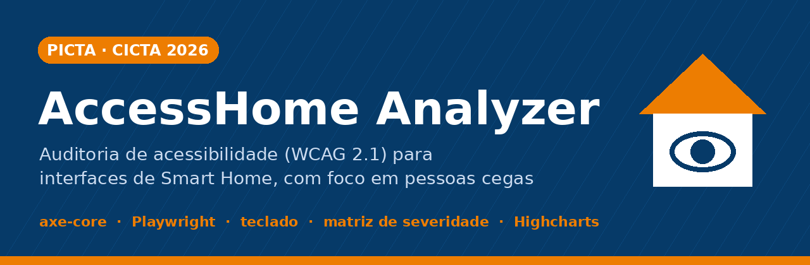
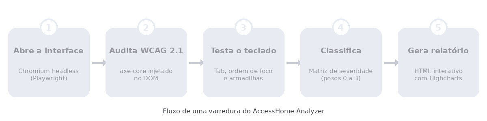
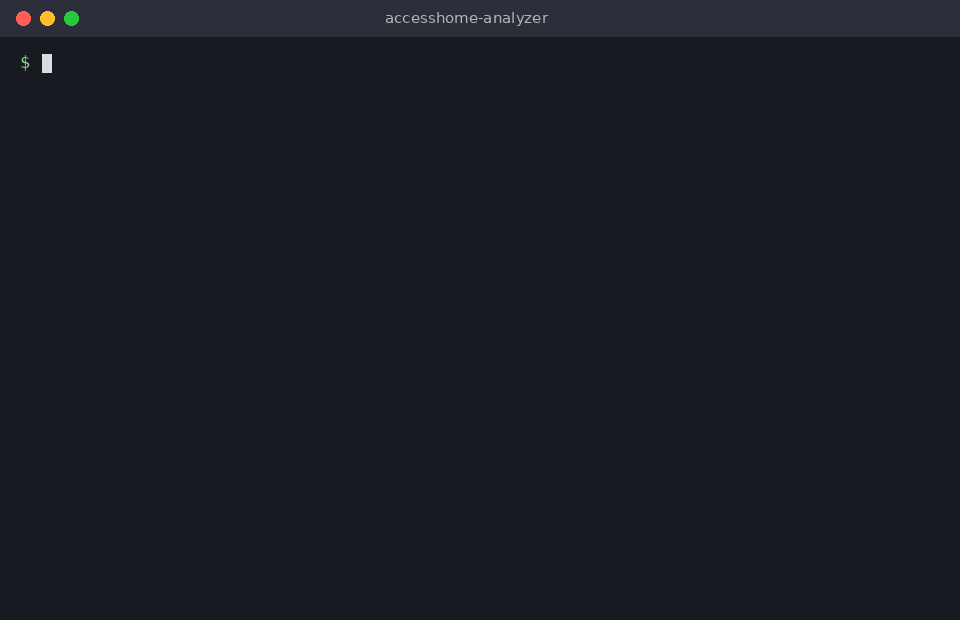
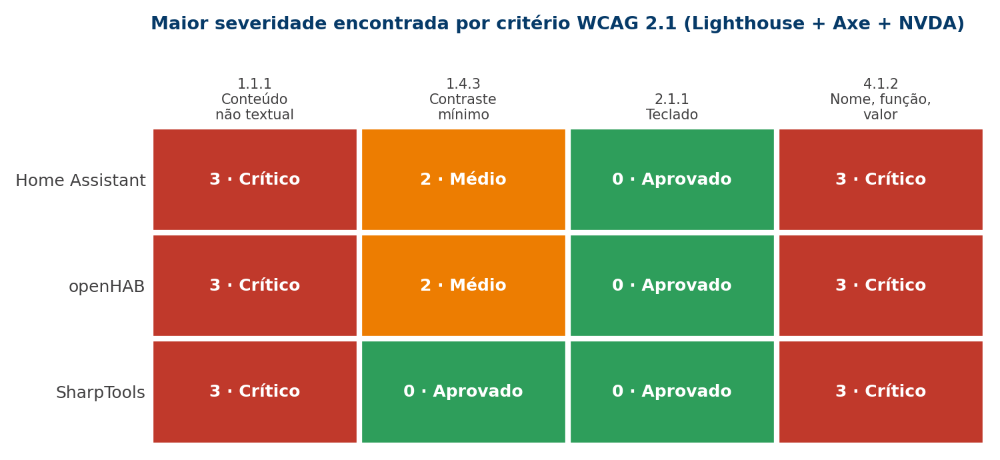
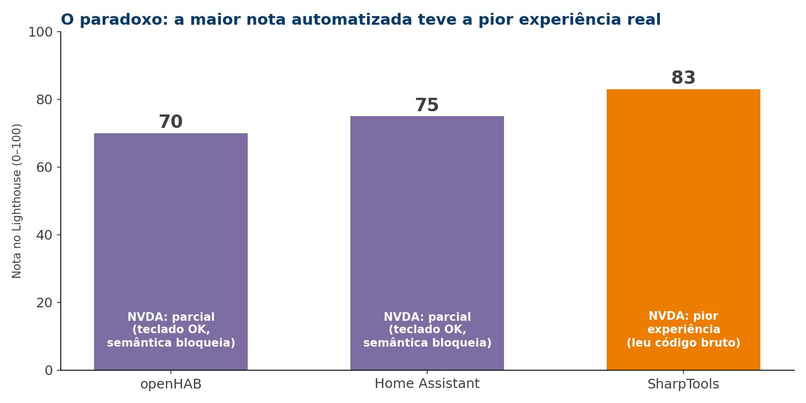

<p align="center">
  
</p>

<p align="center">
  <a href="https://github.com/yago-silva-ads/accesshome-analyzer/actions"></a>
  
  
  
  
</p>

<p align="center">
  <a href="https://yago-silva-ads.github.io/accesshome-analyzer/docs/"><strong>🔗 Abrir o dashboard interativo</strong></a> ·
  <a href="#-instalação">Instalação</a> ·
  <a href="#-uso">Uso</a> ·
  <a href="#-resultados-da-pesquisa">Resultados</a> ·
  <a href="#-base-científica">Base científica</a>
</p>

---

## 📌 Sobre o projeto

O **AccessHome Analyzer** é uma ferramenta de linha de comando que audita a acessibilidade de painéis web de **Smart Home** (casa inteligente). Ela reúne, em uma única execução, a auditoria automatizada **WCAG 2.1** e a simulação de navegação por **teclado**, e classifica cada problema segundo a **matriz de severidade** criada na pesquisa.

Ele é o **produto tecnológico** da pesquisa de iniciação científica *“Análise de ferramentas automatizadas para testes de acessibilidade em interfaces de Smart Home para usuários com deficiência visual”*, desenvolvida por **Yago Santos Silva** no PICTA 2026 do Centro Universitário Senac (São Paulo) e apresentada no **XXI CICTA**.

> **Por que ele existe?** Na pesquisa, foi preciso operar três ferramentas separadas (Lighthouse, Axe DevTools e WAVE) e ainda validar tudo à mão com o leitor de tela NVDA. O AccessHome Analyzer automatiza a parte que pode ser automatizada, usando o motor mais confiável da pesquisa (**axe-core**), e deixa claro o que ainda exige teste humano.

Plataformas avaliadas: **Home Assistant**, **openHAB** e **SharpTools**. A ferramenta funciona com qualquer interface web.

---

## ✨ Funcionalidades

| # | Funcionalidade | Descrição |
|---|---|---|
| 1 | **Varredura em navegador real** | Abre qualquer interface web de Smart Home em Chromium *headless*, incluindo SPAs e páginas com Shadow DOM. |
| 2 | **Auditoria WCAG 2.1** | Injeta o axe-core no DOM e detecta violações dos níveis A e AA. |
| 3 | **Teste de teclado** | Simula a navegação com `Tab`, mapeia a ordem de foco e identifica armadilhas de foco. |
| 4 | **Classificação por severidade** | Atribui a cada violação um peso de 0 a 3, conforme a matriz da pesquisa. |
| 5 | **Relatório interativo** | Gera um relatório HTML com gráficos Highcharts acessíveis. |

### Como funciona

<p align="center">
  
</p>

---

## 🧰 Tecnologias

| Componente | Tecnologia |
|---|---|
| Motor de varredura | Playwright (Chromium *headless*) |
| Auditoria WCAG | axe-core (injetado via JavaScript no DOM) |
| Teste de teclado | Simulação de teclado do Playwright |
| Classificação | Python (algoritmo baseado na matriz de severidade) |
| Relatório | HTML + Jinja2 + Highcharts |
| Interface de terminal | Python `argparse` + Rich |
| CI/CD | GitHub Actions + GitHub Pages |

---

## 📦 Instalação

**Pré-requisitos:** Python 3.12 ou superior e Git.

```bash
git clone https://github.com/yago-silva-ads/accesshome-analyzer.git
cd accesshome-analyzer

python -m venv .venv
.venv\Scripts\activate         # Windows
# source .venv/bin/activate    # Linux/macOS

pip install -r requirements.txt
playwright install chromium
```

---

## 🚀 Uso

```bash
# Varredura básica
python analyzer.py https://demo.home-assistant.io

# Varredura com teste de teclado
python analyzer.py https://demo.home-assistant.io --keyboard

# Varredura completa (auditoria + teclado + relatório)
python analyzer.py https://demo.home-assistant.io --full --output relatorio.html
```

| Opção | O que faz |
|---|---|
| `URL` | Endereço da interface a ser auditada (obrigatório). |
| `--keyboard` | Inclui a simulação de navegação por teclado. |
| `--full` | Executa a auditoria, o teste de teclado e o relatório. |
| `--output ARQUIVO` | Define o nome do relatório HTML gerado. |

### Exemplo de saída

<p align="center">
  
</p>

<details>
<summary>Ver a saída em texto (acessível para leitores de tela)</summary>

```text
AccessHome Analyzer v1.0
Auditoria de acessibilidade · Smart Home

Alvo: https://demo.home-assistant.io
Tempo de varredura: 4,2 s

RESULTADOS
  Violações críticas (peso 3):  9
  Violações sérias (peso 2):   15
  Violações moderadas (peso 1): 0
  Aprovados (peso 0):           2

TESTE DE TECLADO
  Elementos focáveis:              23
  Armadilhas de foco:               0
  Elementos sem indicador visual:   5

Relatório salvo: relatorio.html
```

</details>

---

## ⚖️ Matriz de severidade

Cada barreira encontrada recebe um peso conforme o impacto para quem usa leitor de tela:

| Peso | Nível | Impacto |
|:---:|---|---|
| 🟢 **0** | Aprovado | Nenhuma barreira detectada; a funcionalidade é acessível. |
| 🟡 **1** | Baixo | Dificulta a navegação, mas permite concluir a tarefa. |
| 🟠 **2** | Médio | Gera confusão e exige alto esforço cognitivo. |
| 🔴 **3** | Crítico | Barreira total: impede a conclusão da tarefa. |

Critérios WCAG 2.1 avaliados: **1.1.1** Conteúdo não textual · **1.4.3** Contraste mínimo · **2.1.1** Teclado · **4.1.2** Nome, função, valor.

---

## 📊 Resultados da pesquisa

Os testes foram feitos em agosto de 2026, no Google Chrome e no Windows 11, com Lighthouse, Axe DevTools e WAVE, além de validação manual com o leitor de tela NVDA e sem mouse.

<p align="center">
  
</p>

| Plataforma | Lighthouse | Axe DevTools | WAVE | NVDA (manual) |
|---|:---:|---|---|---|
| Home Assistant | 75/100 | Peso 3 em ARIA e botões | 0 erros (falso negativo) | Teclado OK; a semântica bloqueia |
| openHAB | 70/100 | 7 violações (contraste + ARIA) | 0 erros (falso negativo) | Teclado OK; a semântica bloqueia |
| SharpTools | **83/100** | 4 violações semânticas | 8 erros + 3 de contraste | **Leu código bruto: pior experiência** |

<p align="center">
  
</p>

### Principais achados

- **Barreira universal:** as três plataformas têm barreiras críticas (peso 3) nos critérios 1.1.1 e 4.1.2. Uma pessoa cega não consegue operar a casa sozinha.
- **O problema é semântico:** a navegação por teclado (2.1.1) foi aprovada em todas. O que falha são os rótulos, os *roles* e os atributos ARIA.
- **O paradoxo da nota:** a maior nota no Lighthouse (SharpTools, 83) correspondeu à pior experiência real com o NVDA.
- **Ferramentas:** o Axe DevTools foi a mais confiável; o WAVE gerou falsos negativos em arquiteturas modernas (Shadow DOM, Vue.js); o Lighthouse serve apenas como triagem.
- **Conclusão:** ferramentas automatizadas são um bom filtro inicial, mas o teste com leitor de tela é **indispensável**.

---

## 🖥️ Dashboard interativo

Os resultados consolidados estão em um dashboard publicado no GitHub Pages:

**🔗 [yago-silva-ads.github.io/accesshome-analyzer/docs](https://yago-silva-ads.github.io/accesshome-analyzer/docs/)**

O dashboard apresenta:

- distribuição das violações por severidade e plataforma;
- comparação da efetividade entre Lighthouse, Axe DevTools, WAVE e NVDA;
- radar por plataforma e mapa de calor dos critérios WCAG;
- tabela detalhada de violações;
- assistente de voz para consultar os resultados sem usar a tela.

---

## 🏗️ Arquitetura

```text
CLI (Python) ──► Playwright (Chromium headless) ──► axe-core (auditoria WCAG)
                         │                                   │
                  Simulação de teclado                 Classificação
                  (Tab, ordem de foco)              (matriz de severidade)
                         │                                   │
                         └─────────► Relatório HTML ◄────────┘
                                      (Highcharts)
```

### Estrutura do repositório

```text
accesshome-analyzer/
├── analyzer.py            # CLI principal: varredura, teclado, classificação e relatório
├── requirements.txt       # playwright, jinja2, rich
├── docs/
│   └── index.html         # Dashboard interativo (GitHub Pages)
├── aws/                   # Versão serverless (AWS Lambda) — ver aws/ARCHITECTURE.md
│   ├── lambda_handler.py
│   ├── deploy.py
│   └── template.json
├── assets/                # Imagens e GIFs deste README
└── .github/workflows/
    ├── ci.yml             # Teste de fumaça + publicação do relatório
    └── static.yml         # Publicação do GitHub Pages
```

### Integração contínua

A cada *push* na branch `main` (e toda segunda-feira, às 9h no horário de Brasília), o GitHub Actions executa uma varredura no demo público do Home Assistant, salva o relatório como artefato e publica o site no GitHub Pages.

---

## 🎓 Base científica

Este software é parte integrante da pesquisa:

> SILVA, Y. S. **Análise de ferramentas automatizadas para testes de acessibilidade em interfaces de Smart Home para usuários com deficiência visual**. 2026. Programa de Iniciação Científica e Tecnológica Aplicada (PICTA) – Centro Universitário Senac, São Paulo, 2026.

### Referências principais

- CHOWDHURY, N. et al. An exploration of LLMs for automated assessment of web content accessibility. In: **Proceedings of the ACM Web Conference 2025**. New York: ACM, 2025.
- DAS, S. Accessibility testing for the internet of things: a comprehensive survey. **Journal of Web Engineering**, v. 24, n. 1, p. 45–78, 2025.
- FUGLERUD, K. S. et al. Challenges and possible solutions in accessibility testing of complex IoT interfaces. In: **UAHCI 2024**. Cham: Springer, 2024. p. 87–104.
- STELEA, S. et al. Evaluating automated web accessibility tools in practice. **ACM TACCESS**, v. 18, n. 2, p. 1–35, 2025.
- W3C. **Web Content Accessibility Guidelines (WCAG) 2.1**. 2025. Disponível em: https://www.w3.org/TR/WCAG21/.

---

## ⚠️ Limitações

- Ferramentas automatizadas cobrem apenas parte dos critérios WCAG; **o resultado não substitui o teste com leitor de tela** nem com usuários reais.
- Os testes da pesquisa foram feitos por um único pesquisador sem deficiência visual.
- Próximos passos: testes com pessoas cegas, apps móveis nativos e avaliação longitudinal.

---

## 👤 Autor

**Yago Santos Silva**, Centro Universitário Senac (Campus Santo Amaro).
Orientação: *[nome do(a) orientador(a)]*

## 📄 Licença

Distribuído sob a licença **MIT**: uso livre para fins acadêmicos e comerciais.
